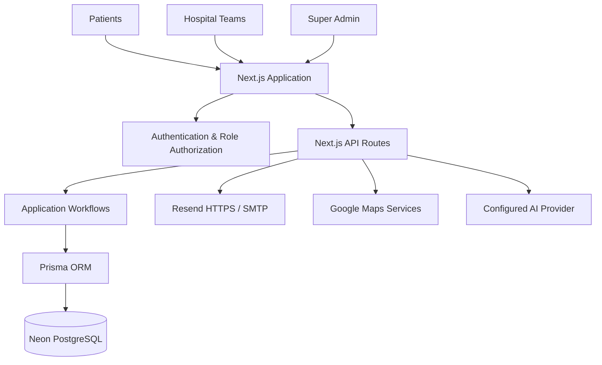

<!-- Jeevan Sahay | Brand palette: Healthcare Navy • Saffron Orange • Care Green --><h1>
  जीवन
  Sahay
</h1>सही अस्पताल। सही समय। सही देखभाल।
AI-Powered Healthcare Navigation & Hospital Management Platform

  <a href="https://jeevansahay-healthtech.onrender.com"><strong>🌐 Live Application</strong></a>
  &nbsp;•&nbsp;
  <a href="https://github.com/riyasingh006/JeevanSahay-HealthTech"><strong>💻 GitHub Repository</strong></a>

<table>
<tr>
<td align="center"><strong>🔎 SEARCH</strong> Hospital listings</td>
<td align="center"><strong>🛏️ CHECK</strong> Reported information</td>
<td align="center"><strong>🩺 BROWSE</strong> Doctor listings</td>
<td align="center"><strong>🚨 CARE</strong> Emergency navigation</td>
</tr>
</table>
🟦 About the Project
Jeevan Sahay is a full-stack healthcare navigation and hospital-management platform that brings patients, hospitals, and platform administrators into one connected digital experience.

Inspired by a simple promise — the right hospital, at the right time, with the right care — the platform combines hospital and doctor discovery, patient workflows, hospital operations, and protected administrative tools.

The application has three role-based experiences:
Portal	Designed for	What it enables
🧑‍⚕️ Patient Portal	Patients and visitors	Discover hospitals, browse doctors, save facilities, request appointments and use protected health-sharing workflows.
🏥 Hospital Portal	Approved hospital teams	Manage facility information, beds, doctors, departments, services, appointments and operational records.
🛡️ Super Admin Portal	Platform administrators	Review hospital applications, manage accounts, triage reports and inspect audit information.

Important: Jeevan Sahay is a healthcare information and workflow platform. Facility-reported availability may be outdated and should be confirmed directly with the facility before travelling. The application does not dispatch emergency services.

🧭 Platform at a Glance

PATIENT EXPERIENCE	HOSPITAL OPERATIONS	PLATFORM OVERSIGHT
Find hospitals	Manage beds	Verify hospitals
Browse doctors	Manage doctors	Manage accounts
Save facilities	Handle appointments	Review reports
Request appointments	Manage services	Audit activity
Protected health sharing	View analytics	Export reports

✨ Features
🧑‍⚕️ Patient Portal
- Patient registration and email verification.
- Password-based and passwordless email-code authentication flows.
- Password recovery and reset.
- Google sign-in when OAuth is configured.
- Private patient profile and protected sessions.
- Hospital discovery and search.
- Doctor and specialist listings.
- Saved hospitals and facilities.
- Appointment requests and cancellation.
- PIN-protected health sharing.
- Emergency-care navigation and facility information.
- Clear labels for sample/demo information.
🏥 Hospital Portal
Hospital access is restricted to approved hospital accounts.
- Hospital dashboard and persisted analytics.
- Bed inventory management.
- Departments and doctor management.
- Hospital services and profile management.
- Appointment handling.
- Emergency case log.
- Notifications and settings.
- Transactional updates from itemised beds to patient-facing availability aggregates.
- Tenant isolation: one hospital cannot read or modify another hospital's records.
🛡️ Super Admin Portal
- Protected overview and analytics.
- Hospital application verification and rejection.
- Searchable account management.
- Account suspension and reactivation.
- Report triage.
- CSV exports.
- Read-only audit review.
- Role-checked and audited administrative actions.
- Session revocation where appropriate.
🔐 Authentication & Access Control
- Revocable sessions and role checks.
- Google OIDC/PKCE sign-in when configured.
- Hashed, time-limited and attempt-limited OTPs.
- Hospital approval workflow.
- Hospital applicants remain pending until approved by a super-admin.
- Approval requires verified email and confirmed map coordinates.
- No public super-admin registration.
- Approval/rejection is transactional and creates an in-app notification; email is sent when delivery is configured.
🤖 AI Healthcare Assistant
The project contains an AI assistant integration with request handling and streaming-reliability safeguards. AI provider credentials and model configuration are server-side.

Provider compliance is a release blocker for clinical use. The Gemini API terms documented in this repository restrict clinical-practice use and providing medical advice, and include consumer and under-18 restrictions. These conditions conflict with the intended healthcare-assistant scope. Do not enable Gemini for real-patient symptom analysis, health advice or emergency guidance, and do not submit real patient data to Gemini. Before enabling the assistant for its intended audience and scope, select a provider/service whose current terms explicitly permit that use and whose privacy, retention and data-processing controls meet the application's requirements.

store: false is not a zero-data-retention guarantee and does not override provider terms.
🎨 Design Language
The product interface uses a clean healthcare-navigation style:
Brand element	Direction
Healthcare Navy	Primary navigation, headings, key actions and trust-focused surfaces
Saffron Orange	Highlights, emphasis and important visual accents
Care Green	Positive states and care-related indicators
Clean White	Main surfaces and content areas
Soft Blue / Light Neutral	Supporting panels, borders and backgrounds
Rounded cards	Clear, approachable information grouping
Responsive layouts	Desktop, laptop, tablet and mobile use

The README uses the same navy/orange/green visual direction. GitHub controls README rendering, so custom CSS and exact website styling cannot be imposed on the repository page.
📱 Responsive Experience
The application has undergone a local responsive audit and targeted layout corrections.

Reported post-fix verification:
- 32 application routes.
- 10 viewport sizes, from 320px mobile width through 1440px desktop width.
- 320 route/viewport combinations.
- Zero horizontal-overflow issues in the reported post-fix matrix.
- Zero navigation/evaluation failures in that audit.
- Desktop screenshot comparison at 1440 × 900.
These are local audit results for the development branch. They do not prove that the changes have been merged or deployed to the live application. Re-run responsive checks after later UI changes and verify the deployed build separately.
🧱 Technology Stack
Layer	Technology
Framework	Next.js 16
UI	React, TypeScript, CSS Modules and Tailwind utilities where used
Runtime	Node.js 22
ORM	Prisma 6
Database	PostgreSQL
Production database	Neon PostgreSQL
Authentication	Application-managed sessions, jose, bcryptjs, Google OIDC/PKCE
Email	Resend HTTPS API or provider-compatible SMTP
Maps	Google Maps / Places / Geocoding when configured
AI integration	Configurable server-side AI provider integration
Hosting	Render Web Service
Quality checks	Project test scripts, TypeScript, ESLint and production build

🏗️ System Architecture

Architecture note: the UI and /api/* routes run in the same Next.js application and share one origin. There is no separately deployed frontend/backend pair in the current architecture.
🗃️ Database & Data Handling
- PostgreSQL is the sole active Prisma provider.
- Runtime queries use Neon's pooled connection URL.
- Prisma migrations use Neon's direct connection URL.
- A versioned PostgreSQL baseline preserves current models, relations, constraints and indexes.
- Historical SQLite migration SQL is retained in prisma/migrations-sqlite-legacy/ for reference and is not part of the active PostgreSQL migration path.
- The provider migration creates PostgreSQL schema objects; it does not copy rows from a separate SQLite database.
- Production application data is stored in Neon, not on Render's ephemeral filesystem.
- Bed inventory updates and patient-facing availability aggregates are updated transactionally.
Demo Data vs Operational Data
Demo accounts and sample hospitals/doctors are explicitly marked. Regular patient searches and public statistics exclude those fixtures. Demo accounts see sample-data labels, and sample records cannot be treated as confirmed capacity or used to book care.

Demo data is fictional. It must never be used for real-care decisions.
🔒 Security & Privacy
- Session cookies are HttpOnly and SameSite=Lax; production cookies use Secure.
- OTPs are hashed, expire after five minutes, are attempt-limited, and are never returned or logged.
- Hospital records are tenant-scoped.
- Administrative actions are role-checked and audited.
- Relevant administrative actions can revoke sessions.
- Secrets and provider credentials are not stored in the repository.
- .env must remain out of Git.
- Use fictional data for development and tests.
- Never use production databases for integration testing.
- Review provider terms, retention behavior and data-processing controls before sending sensitive information to an AI service.
⚙️ Local Setup
Prerequisites
- Node.js 22
- npm
- PostgreSQL database (local PostgreSQL or Neon)
- Git
1. Clone the repository
git clone https://github.com/riyasingh006/JeevanSahay-HealthTech.git
cd JeevanSahay-HealthTech
2. Install dependencies
npm ci
3. Create your environment file
cp .env.example .env
Windows PowerShell:
Copy-Item .env.example .env
Add the required local values to .env. Generate a unique SESSION_SECRET of at least 32 bytes. Never commit secrets or paste them into screenshots, issues or pull requests.
4. Configure PostgreSQL
Set:
- DATABASE_URL — pooled PostgreSQL URL for application queries.
- DIRECT_URL — direct, non-pooled PostgreSQL URL for Prisma migrations.
For Neon, the pooled hostname contains -pooler; the direct hostname does not. Keep both URLs private and use TLS.
5. Apply migrations
npm run db:migrate:deploy
6. Start the application
npm run dev
Open http://localhost:3000.

Existing users and hospitals are not created automatically. Use the super-admin bootstrap procedure when the first administrator is required.
🔑 Environment Variables
Variable	Requirement	Purpose
DATABASE_URL	Required	Neon pooled PostgreSQL URL for runtime queries. Secret.
DIRECT_URL	Required	Direct PostgreSQL URL for Prisma migrations. Secret.
TEST_DATABASE_URL	Tests only	Disposable local PostgreSQL test database. Tests reject remote hosts and non-test database names. Never use production.
SESSION_SECRET	Required	Random session/token signing secret of at least 32 bytes.
SMTP_HOST	Conditional	SMTP host when Resend is not configured.
SMTP_PORT	Conditional	Provider-supported SMTP port.
SMTP_USER	Conditional	SMTP username.
SMTP_PASSWORD	Conditional	SMTP password; store as a deployment secret.
SMTP_FROM	Email required	Sender identity verified with the selected provider.
SMTP_SECURE	Optional	SMTP TLS mode. false uses STARTTLS; true uses implicit TLS. Port 465 implies TLS.
RESEND_API_KEY	Optional	Resend HTTPS API key; preferred on Render Free when sender is verified.
NEXT_PUBLIC_APP_URL	Optional on Render	Canonical public HTTPS origin for links and OAuth. Not a secret.
GOOGLE_CLIENT_ID	Optional	Google OAuth Web application client ID.
GOOGLE_CLIENT_SECRET	Optional	Google OAuth client secret; server-side only.
GOOGLE_REDIRECT_URI	Optional	Exact OAuth callback URL registered in Google Cloud Console.
GOOGLE_MAPS_API_KEY	Optional	Google Places/Geocoding integration.
GEMINI_API_KEY	Optional	Gemini integration key; do not enable for prohibited healthcare use.
GEMINI_MODEL	Optional	Gemini model override; verify current availability and terms.
OPENAI_API_KEY	Optional	OpenAI API key for configured integration.
OPENAI_BASE_URL	Optional	Custom OpenAI-compatible base URL.
OPENAI_MODEL	Optional	Model name for configured OpenAI-compatible integration.
SEED_DEMO_DATA	Keep false in production	Enables fictional local demo fixtures; production seeding is refused.
SEED_SUPER_ADMIN_EMAIL	Bootstrap only	First super-admin email.
SEED_SUPER_ADMIN_PASSWORD	Bootstrap only	Temporary unique password, 16–72 bytes; remove after provisioning.
SEED_SUPER_ADMIN_NAME	Optional	First super-admin display name.
NODE_VERSION	Blueprint-managed	Pins Node.js 22.
PORT	Render-managed	Port supplied by Render.
NODE_ENV	Render-managed	Runtime environment supplied by Render.
RENDER_EXTERNAL_URL	Render-managed	Public Render service URL.

Email Configuration
Real OTP verification, password recovery and notifications require either:
1. Resend HTTPS API with a verified sender domain; or
2. SMTP settings supported by the provider and hosting network.
Render Free blocks outbound SMTP ports 25, 465 and 587. Port 2525 is provider-specific, not a universal workaround. Prefer Resend HTTPS on Render Free when configured and verified.
Google OAuth Configuration
Create a Google OAuth client of type Web application.

Production callback:
https://<your-public-host>/api/auth/google/callback
Local callback:
http://localhost:3000/api/auth/google/callback
The callback must exactly match the URI registered in Google Cloud Console. The current server-side flow does not require an Authorized JavaScript origin; if populated, use only the origin without a path.
👑 First Super Admin Setup
There is no public super-admin registration.
1. Confirm the intended database has been migrated.
2. Set SEED_SUPER_ADMIN_EMAIL and a unique SEED_SUPER_ADMIN_PASSWORD (16–72 bytes). SEED_SUPER_ADMIN_NAME is optional.
3. Run the seed command from a trusted environment:
npm run db:seed
4. Verify the account.
5. Remove the temporary password immediately.
The seed is idempotent only for the same first admin. It refuses a second super-admin and refuses promotion of an existing non-admin account. For Render Free, run this from a trusted local terminal against the intended database; the Free web service does not provide Shell access.
🧪 Testing & Quality Checks
Run from the repository root:
npm run typecheck
npm run lint
npm run test:scoring
npm run test:oauth
npm run test:database
npm run test:email
npm run test:auth
npm run test:gemini
npm audit
npm run build
Test Database Safety
npm run test:auth requires TEST_DATABASE_URL pointing to a disposable local PostgreSQL database whose name includes test. It refuses remote hosts and non-test database names, then resets only that explicitly named local test database. It also starts a local SMTP capture server and removes any inherited Resend API key so tests cannot send real email.

npm run test:database requires a disposable local PostgreSQL database. It tests URL bounds, error redaction and recovery after a connection is forcibly closed. It does not reset the database or connect to Neon.

Additional test notes:
- test:email mocks the Resend HTTPS API and checks sanitized failures without network email.
- test:oauth checks HTTPS/public-origin and callback validation offline.
- OAuth integration tests check PKCE/state/nonce binding and reject state replay. Live Google sign-in still requires owner-managed Google Cloud configuration.
- Scoring tests check emergency-priority ordering.
- Gemini reliability tests do not establish provider availability, provider-term compliance or clinical suitability.
🚀 Deployment: Render + Neon
The repository's render.yaml defines one Next.js web service. The UI and /api/* routes share the same origin.
Deployment setting	Configuration
Hosting	Render Web Service
Database	Neon PostgreSQL
Runtime	Node.js 22
Persistent application data	Neon
Auto-deploy	Disabled in the configured Blueprint
Health check	/api/health
Startup	Prisma migrations, then Next.js

Startup command:
npm run db:migrate:deploy && exec npm run start -- --hostname 0.0.0.0 --port $PORT
Database URL Rules
Variable	Connection type
DATABASE_URL	Neon pooled endpoint; hostname includes -pooler; application queries only.
DIRECT_URL	Neon direct endpoint; no -pooler; Prisma migrations only.

The application applies bounded pool and timeout parameters to the runtime URL. Do not add the legacy pgbouncer=true flag for Neon's current PgBouncer configuration.
Health Check
/api/health is a public process-level check. It verifies that the Next.js process can respond; it does not wait for Neon, email delivery or an AI provider. A successful health check does not prove that every external dependency is healthy.
Render Free Plan Notes
- Services sleep after 15 minutes without inbound traffic and can take about a minute to wake.
- The filesystem is ephemeral; do not store persistent user data there.
- Free services have no attached persistent disk.
- Outbound SMTP ports 25, 465 and 587 are blocked.
- Keep auto-deploy disabled until changes have been reviewed and explicitly approved.
Official references: Render Free services · Render health checks.
Release Checklist
- [ ] Review the pull request and all changed files.
- [ ] Confirm required CI checks are green.
- [ ] Confirm database tests used only a disposable local database.
- [ ] Review migrations and take a backup before applying later schema changes.
- [ ] Verify Render and Neon environment values without exposing secrets.
- [ ] Verify Google OAuth callback settings if enabled.
- [ ] Verify email sender domain and delivery settings.
- [ ] Confirm AI provider terms and data controls permit the intended use.
- [ ] Merge only after review and explicit approval.
- [ ] Deploy intentionally and smoke-test production flows.
Never run npm run db:push in production. Use reviewed, versioned Prisma migrations.
🧩 Provider Lifecycle & Governance
AI provider models and terms change over time. The project documentation notes that Google lists gemini-3.1-flash-lite for shutdown on 7 May 2027 and recommends gemini-3.5-flash-lite as its replacement. The documented maintenance reminder is to remove the old fallback by 7 April 2027, then rerun npm run test:gemini after checking Google's current model documentation.

Always re-check model availability, supported regions, usage terms, privacy commitments and data-processing agreements before release.
🧰 Development Workflow
1. Create a dedicated feature/fix branch.
2. Inspect the repository and current Git status before editing.
3. Keep changes narrowly scoped and preserve existing workflows.
4. Add or update tests for changed behavior.
5. Review Prisma migration SQL before committing schema changes.
6. Run typecheck, lint, relevant tests and production build.
7. Inspect the complete diff before opening a pull request.
8. Never commit .env, API keys, passwords, database URLs or patient data.
9. Do not merge or deploy without review and approval.
🧯 Troubleshooting
Issue	What to check
Database connection or migration failure	Confirm DATABASE_URL is pooled, DIRECT_URL is direct, TLS is enabled and the target database is reachable.
Auth/database tests refuse to run	Use a disposable local PostgreSQL database with test in its name. Never bypass the safety guard with production credentials.
OTP/email delivery fails	Verify sender domain, provider credentials, SMTP host/port/TLS support and Render network restrictions.
Google sign-in callback error	Compare the exact callback URI and public origin with Google Cloud Console.
Health check succeeds but a feature fails	/api/health checks process liveness only; inspect the relevant dependency separately.
First request after inactivity is slow	A Render Free service may be waking from sleep.
Hospital is not approved	Applicants remain pending until a super-admin completes the required approval workflow.
Demo availability appears	Check sample-data labels; demo inventory is fictional, not confirmed capacity.

🤝 Contributing
Focused improvements are welcome.
1. Fork the repository.
2. Create a feature branch.
3. Preserve existing portal design and workflows unless a change is explicitly intended.
4. Add or update tests.
5. Run the relevant quality checks.
6. Open a pull request describing the issue, approach, changed files and validation evidence.
Never include real patient data, secrets, private database URLs or production credentials in issues, screenshots, fixtures or pull requests.
📄 License
No license grant is specified in this README. Unless a license file is added to the repository, do not assume that reuse, redistribution or commercial use is permitted.

जीवन Sahay
Technology with care. Access with trust.

One connected platform for patients, hospitals and administrators.

Built with Next.js · TypeScript · Prisma · PostgreSQL

